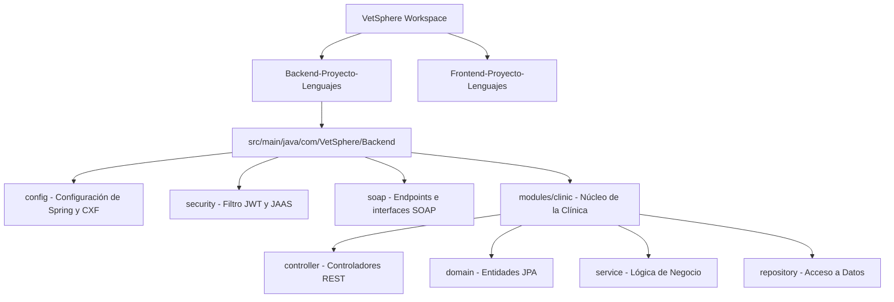
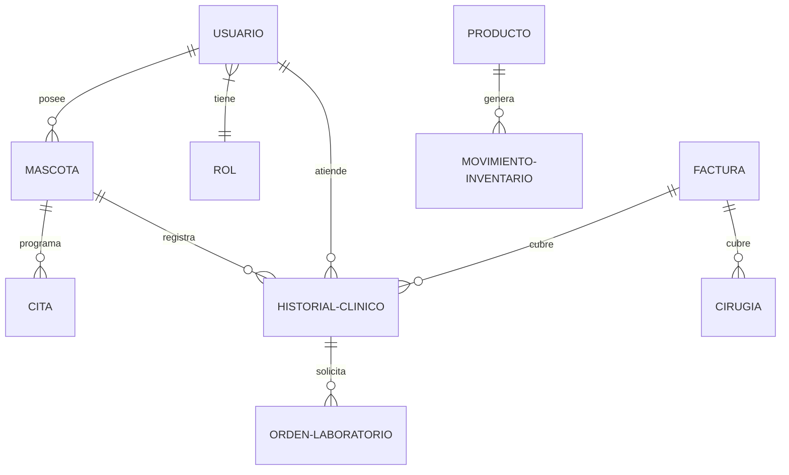
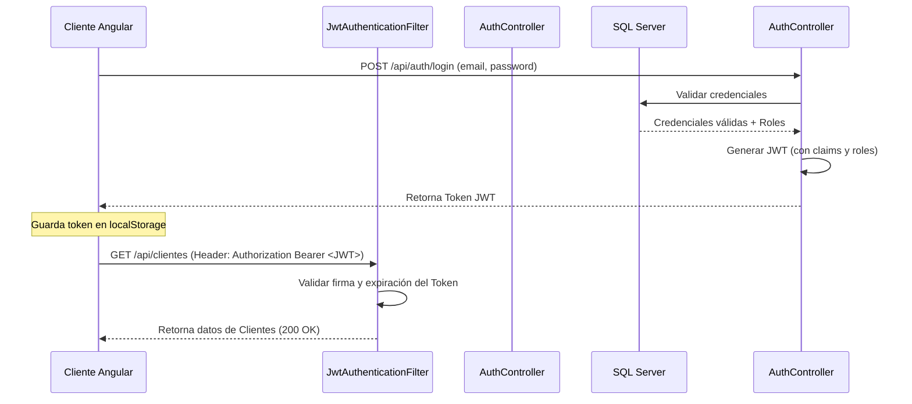
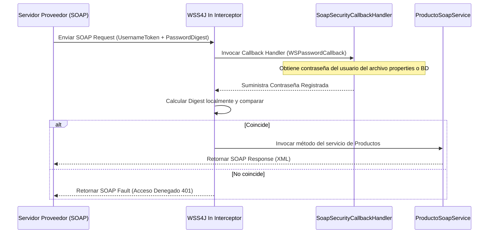

# MANUAL DE DESARROLLO Y ARQUITECTURA DE VETSPHERE

Este documento detalla la arquitectura, el diseño de base de datos, la estructura de clases, el flujo de seguridad y la configuración de despliegue del sistema de información clínica veterinaria **VetSphere**.

---

## 1. ESTRUCTURA Y DIRECTORIOS DEL PROYECTO

El proyecto se divide de manera desacoplada en dos repositorios principales: el backend desarrollado en Java y el frontend desarrollado en Angular.



### 1.1 Estructura del Backend (Java)
El backend sigue el estándar de diseño por capas (Layered Architecture) y organización por módulos de negocio:
*   `src/main/java/com/VetSphere/Backend/VetSphereBackendApplication.java`: Clase principal que arranca la aplicación Spring Boot.
*   `config/`: Contiene clases de configuración global de la aplicación.
*   `security/`: Alberga los componentes para la autenticación REST y los Callback Handlers de seguridad SOAP.
*   `soap/`: Estructura los endpoints SOAP y servicios de integración expuestos.
*   `modules/clinic/`: Concentra todo el núcleo de lógica de negocio clínica de VetSphere, organizado en:
    *   `domain/`: Entidades JPA de persistencia mapeadas a la base de datos relacional.
    *   `dto/`: Objetos de transferencia de datos (Data Transfer Objects) para solicitudes y respuestas.
    *   `repository/`: Interfaces que extienden `JpaRepository` para el acceso a datos.
    *   `service/`: Clases de servicios que concentran las reglas de negocio y transacciones.
    *   `controller/`: Controladores REST que exponen las APIs públicas consumidas por Angular.

### 1.2 Estructura del Frontend (Angular 17)
El frontend implementa una arquitectura basada en componentes reutilizables y enrutamiento modular:
*   `src/app/`: Carpeta contenedora de componentes, servicios e interceptores.
*   `src/app/components/`: Vistas independientes del sistema (Citas, Historial Clínico, Clientes, Facturación, Inventario, etc.).
*   `src/app/services/`: Clases de servicio Angular que inyectan el cliente `HttpClient` para comunicarse con las APIs del backend.
*   `src/app/interceptors/`: Interceptores HTTP que inyectan de manera automática las cabeceras JWT en cada petición.
*   `src/styles.css`: Archivo de configuración CSS global donde se importa y personaliza el framework **TailwindCSS**.

---

## 2. PERSISTENCIA DE DATOS (MODELO DE BASE DE DATOS)

El sistema utiliza **Microsoft SQL Server** para almacenar la información de manera estructurada y persistente a través del ORM **Hibernate**:



### 2.1 Entidades JPA Principales
1.  **Usuario (`Usuario.java`):** Almacena las credenciales de ingreso (correo cifrado, contraseña hash), información personal y el estado de la cuenta (activo/inactivo).
2.  **Rol (`Rol.java`):** Define los niveles de acceso del sistema: `ADMIN` (administrador general), `VETERINARIO` (personal médico), `RECEPCIONISTA` (gestión de citas y caja) y `CLIENTE` (dueño de las mascotas).
3.  **Mascota (`Mascota.java`):** Registra el nombre, especie, raza, fecha de nacimiento, peso y la relación con su dueño (Usuario).
4.  **Cita (`Cita.java`):** Controla la agenda de la clínica (fecha, hora, motivo, veterinario asignado y estado: pendiente, cancelada o atendida).
5.  **HistorialClinico (`HistorialClinico.java`):** Almacena el diagnóstico, tratamiento, notas médicas y peso registrado en cada consulta médica.
6.  **Factura (`Factura.java`):** Detalla los cobros realizados por conceptos de consultas, cirugías, hospitalizaciones o venta directa de productos.
7.  **Producto (`Producto.java`):** Modela el inventario de medicamentos, alimentos y accesorios (código de barras, nombre, stock actual, stock mínimo y precio).
8.  **Hospitalizacion y Cirugia (`Hospitalizacion.java`, `Cirugia.java`):** Módulos especializados para registrar internamientos de mascotas y programaciones quirúrgicas.

---

## 3. CAPA DE SERVICIOS REST Y SEGURIDAD JWT

### 3.1 Flujo de Autenticación REST
La comunicación entre Angular y Spring Boot está blindada mediante tokens JWT firmados digitalmente:



1.  **Solicitud de Acceso:** El cliente envía sus credenciales al controlador `AuthController`.
2.  **Generación del Token:** Tras validar las credenciales, `JwtService` firma un token que contiene la fecha de emisión, expiración y la lista de roles del usuario.
3.  **Almacenamiento Local:** El frontend almacena el token en su `localStorage`.
4.  **Interceptores de Angular:** Para cualquier petición subsecuente, un interceptor captura la solicitud saliente y le inyecta la cabecera:
    `Authorization: Bearer <Token_JWT>`
5.  **Filtro de Seguridad (`JwtAuthenticationFilter`):** En el backend, cada petición es interceptada por este filtro que extrae y valida el token. Si es correcto, establece la identidad del usuario en el contexto de seguridad de Spring para autorizar el acceso al recurso.

---

## 4. CAPA SOAP E INTEGRACIÓN CON WS-SECURITY

Para los procesos de integraciones de negocio (B2B) como actualizaciones masivas de inventario por parte de proveedores, VetSphere publica servicios web SOAP seguros.

### 4.1 Endpoint SOAP (`ProductoSoapEndpoint.java`)
El endpoint se expone en la ruta `/soap/productos` y permite la consulta de stock, creación de productos y actualización de precios mediante mensajería estructurada XML.

### 4.2 Arquitectura de Seguridad (UsernameToken y PasswordDigest)
El acceso al WSDL de SOAP está protegido mediante políticas de seguridad aplicadas a nivel de mensaje (Message-Level Security) usando la especificación **WS-Security**:

*   El mensaje SOAP debe incluir un elemento `<wsse:Security>` dentro de la cabecera `<soap:Header>`.
*   Se emplea el perfil de autenticación **UsernameToken** con la contraseña cifrada mediante **PasswordDigest**.
*   El servidor utiliza **WSS4J** para analizar las cabeceras XML y delega la comprobación en la clase **`SoapSecurityCallbackHandler`**.



### 4.3 Implementación de JAAS (`SoapSecurityCallbackHandler.java`)
El framework **JAAS** desacopla la autenticación del código del controlador de negocio. El handler implementa la interfaz estándar `javax.security.auth.callback.CallbackHandler`. Al interceptar la cabecera, extrae el identificador del usuario y suministra la contraseña esperada desde las propiedades de configuración (`application.properties`). WSS4J calcula el hash localmente combinando el Nonce y Created del cliente y autoriza o rechaza la transacción.

---

## 5. GENERACIÓN DE REPORTES Y SERVICIOS AUXILIARES

Para asistir en la toma de decisiones clínicas y financieras, VetSphere incorpora servicios de exportación programática de datos:

### 5.1 Reportes en Hojas de Cálculo (Apache POI)
El controlador `ReporteController` utiliza la librería **Apache POI** para estructurar hojas de cálculo dinámicas en formato OpenXML (`.xlsx`):
*   Se generan reportes de compras de medicamentos, ventas de servicios y listados de pacientes.
*   Permite aplicar formato condicional, auto-ajuste de columnas y encabezados estilizados con colores institucionales.

### 5.2 Documentación Clínica y Facturación en PDF (OpenPDF)
Para la expedición de comprobantes de caja, recetas y hojas de historial clínico, se implementa **OpenPDF**:
*   Generación en caliente de documentos PDF que no residen en el servidor, sino que se transmiten directamente al cliente en el flujo de respuesta (`outputStream`).
*   Configuración de cabeceras, pie de página automatizado, logotipos institucionales embebidos en el documento y tablas con bordes estilizados.

### 5.3 Envío de Correos y Seguridad de Doble Factor
Para robustecer el registro de clientes y la recuperación de credenciales, el sistema incorpora **JavaMail Sender**:
*   Envío de correos transaccionales mediante `SimpleMailMessage` (códigos de verificación y recuperación de contraseña).
*   Generación de códigos OTP (One-Time Password) de 6 dígitos con expiración de 10 minutos, almacenados en la tabla `CodigoVerificacion` de SQL Server.

---

## 6. GUÍA DE EJECUCIÓN DEL DESARROLLO

### 6.1 Requisitos del Sistema
*   **Java Development Kit (JDK):** Versión 17 LTS (por ejemplo, Eclipse Temurin 17).
*   **Node.js:** Versión 18 o superior (v24 recomendada) para el frontend Angular.
*   **Base de Datos:** Microsoft SQL Server (2019 o posterior) configurado con autenticación mixta o Windows.
*   **IDE Recomendados:** IntelliJ IDEA para el backend Java, y VS Code para el frontend Angular.

### 6.2 Ejecución del Backend (Spring Boot)
1.  Crear la base de datos `VeterinariaDB` en SQL Server.
2.  Configurar las credenciales de acceso a la base de datos en `src/main/resources/application-local.properties`:
    ```properties
    spring.datasource.url=jdbc:sqlserver://localhost:1433;databaseName=VeterinariaDB;encrypt=true;trustServerCertificate=false
    spring.datasource.username=tu_usuario
    spring.datasource.password=tu_contrasena
    ```
3.  Ejecutar el backend en la terminal:
    ```bash
    mvn spring-boot:run
    ```
4.  El backend levantará un servidor Tomcat embebido en el puerto `8080`.
    *   API REST: `http://localhost:8080/api`
    *   WSDL SOAP: `http://localhost:8080/soap/productos?wsdl`

### 6.3 Ejecución del Frontend (Angular)
1.  Abrir la carpeta del frontend en la terminal.
2.  Instalar las dependencias de node:
    ```bash
    npm install
    ```
3.  Arrancar el servidor de desarrollo:
    ```bash
    npm start
    ```
4.  Abrir el navegador en: `http://localhost:4200`
5.  **Credenciales de Administrador Sembradas de Fábrica:**
    *   Usuario: `admin1@vetsphere.com`
    *   La contraseña se configura únicamente para el entorno de pruebas local mediante `DEMO_SEED_PASSWORD`; no se publica en esta documentación.

---

## CONCLUSIÓN DE ARQUITECTURA
El desarrollo de VetSphere demuestra cómo una arquitectura moderna híbrida puede coexistir de forma armónica. REST proporciona la agilidad y ligereza que la capa visual en Angular 17 demanda para el uso diario en clínica. Mientras tanto, la robustez del protocolo SOAP con Apache CXF y blindado mediante WS-Security y JAAS, garantiza que cualquier interacción transaccional con proveedores o facturadores externos se realice de manera segura, formal y auditable.
