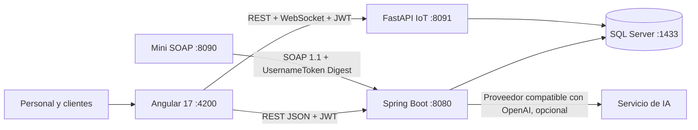

# Informe integral del proyecto VetSphere

**Fecha:** 31 de octubre de 2026  
**Repositorio:** [iLavtzhyy/VetSphere-Proyecto-Final-LoT](https://github.com/iLavtzhyy/VetSphere-Proyecto-Final-LoT)  
**Rama revisada:** `main` · commit `2de9da6`

## 1. Resumen ejecutivo

VetSphere es una plataforma web para administrar una clínica veterinaria. Reúne la atención clínica, la recepción, la farmacia, la facturación y los reportes en una interfaz Angular conectada a un backend Spring Boot y SQL Server. También incluye una integración SOAP para intercambio con una sucursal, un asistente conversacional conectado a funciones del sistema y un módulo de cadena de frío IoT con simulación de sensores.

La solución funciona como un conjunto de cuatro servicios locales: aplicación Angular, API REST/SOAP principal, servicio IoT FastAPI y cliente/sucursal Mini SOAP. El servicio IoT puede demostrarse sin sensores físicos y está separado de la recepción futura de lecturas reales.

## 2. Objetivos y alcance

- Centralizar la información de propietarios, mascotas, citas y atenciones clínicas.
- Dar a cada rol acceso a las funciones que necesita.
- Trazar inventario, ventas, cupones, pagos y eventos relevantes.
- Integrar servicios internos mediante REST y una sucursal externa mediante SOAP con WS-Security.
- Ofrecer un asistente conversacional limitado por permisos y respaldado por datos de la aplicación.
- Monitorear temperaturas de medicamentos y vacunas, generar alertas y guardar historial; en demostraciones, generar lecturas mediante simulación.

El módulo de cadena de frío está preparado para aceptar sensores físicos por REST, pero la demostración local usa valores generados por software. No requiere ESP32 ni hardware externo.

## 3. Arquitectura



### Servicios y puertos locales

| Servicio | Tecnología | Puerto | Responsabilidad |
|---|---|---:|---|
| Interfaz web | Angular 17, TypeScript, Tailwind CSS | 4200 | Portal público, panel clínico y herramientas administrativas |
| API principal | Java 17, Spring Boot 3.3.5 | 8080 | Autenticación, permisos, negocio clínico, farmacia, cobro, reportes y SOAP |
| Cadena de frío | Python, FastAPI | 8091 | Sensores, simulador, lecturas, alertas, exportaciones y WebSocket |
| Mini SOAP | Java 17, Spring Boot | 8090 | Aplicación de sucursal para probar integración B2B |
| Base de datos | SQL Server Express/Developer | 1433 | Persistencia principal y datos de inventario de la sucursal |

La configuración Docker Compose permite ejecutar una variante del ecosistema en contenedores. El servicio Mini SOAP se activa con el perfil `soap`.

## 4. Tecnologías

### Backend principal

- Java 17 y Spring Boot 3.3.5.
- Spring Web, Spring Security, Spring Data JPA, Bean Validation y Spring Mail.
- SQL Server con JDBC y Hibernate.
- JWT con JJWT, contraseñas con BCrypt y autorización centralizada.
- Apache CXF y WSS4J para SOAP/WS-Security.
- Apache POI para hojas Excel; OpenPDF para documentos PDF; ZXing para códigos QR.
- Springdoc OpenAPI para documentación de API.
- JUnit 5, Mockito, MockMvc, H2 y JaCoCo para pruebas.

### Frontend

- Angular 17 standalone, TypeScript, Angular Router y RxJS.
- Tailwind CSS y componentes compartidos propios.
- Jasmine, Karma y Angular CLI para pruebas y compilación.

### Servicio IoT

- Python, FastAPI, Uvicorn y PyJWT.
- pyodbc para SQL Server.
- ReportLab para PDF y openpyxl para Excel.
- WebSocket para publicar lecturas, alertas y cambios de simulación al panel.

### Servicio Mini SOAP

- Java 17, Spring Boot, Spring Data JPA y SQL Server.
- Cliente SOAP con WS-Security para invocar las operaciones del backend principal.

## 5. Módulos funcionales

### Portal y gestión de cuentas

- Inicio público, registro, inicio de sesión, verificación por código, recuperación de contraseña y reactivación de cuenta.
- Administración de usuarios, cambios de rol, aprobación de personal y bloqueo/reactivación de cuentas.
- Perfil personal y pantalla **Mi cuenta**.
- La autenticación usa JWT; los permisos se vuelven a validar en backend.

### Gestión clínica y recepción

- Dashboard con indicadores operativos.
- Agenda y recepción de citas con estados y flujo de admisión.
- Fichas de clientes y mascotas, fotografías, historial clínico y archivos adjuntos.
- Consultas, triage, cirugías, laboratorio, hospitalización, vacunación, seguimiento, urgencias e imagenología.
- Consentimientos y turnos del personal.
- El equipo veterinario dispone de una cartelera pública con información profesional.

### Farmacia, compras y facturación

- Catálogo e inventario de farmacia, productos de stock crítico y movimientos de existencias.
- Proveedores, órdenes de compra y análisis de rotación.
- Cupones con alcance, vigencia y condiciones de uso.
- Facturación de servicios y productos. El backend valida importes, descuentos, IVA y total; el navegador no es la autoridad de cálculo.
- Exportación de reportes PDF y Excel.

### Chatbot VetSphere

- El widget permite consultas en lenguaje natural y conserva conversaciones en base de datos.
- El backend usa llamadas a funciones para consultar información autorizada de la clínica.
- Las herramientas disponibles y los datos accesibles se limitan según el rol. El chatbot debe informar cuando una acción o dato no está permitido.
- El panel de administración permite consultar y borrar conversaciones. La retención automática está configurada a siete días por defecto.
- El proveedor de IA es externo y configurable; el sistema puede responder como no configurado cuando no existe una clave de API.

### Cadena de frío IoT para medicamentos

- Panel administrativo en Angular, disponible en `/cadena-frio` y protegido para `ROLE_ADMIN`.
- CRUD de neveras y sensores, lecturas históricas, estadísticas, alertas y asignación de productos a almacenamiento refrigerado.
- Simulación de temperaturas `NORMAL`, `WARNING` y `CRITICAL`, con intervalo permitido de 5 a 10 segundos.
- Simulación de sensores conectados/desconectados y acción para forzar una lectura crítica.
- Lecturas y alertas se guardan en tablas SQL Server `iot_*`; el panel recibe cambios por WebSocket.
- Las lecturas se distinguen como simuladas. El endpoint REST para sensores físicos usa una credencial individual por dispositivo y rechaza lecturas enviadas por sensores marcados como simulados.
- Exportación filtrada de mediciones a Excel o PDF. El PDF incluye resumen, temperaturas, estado de rango, origen, filtros, paginación y pie de página.

### Integración SOAP

- El backend publica `/soap/productos` con WSDL.
- Las operaciones de inventario usan SOAP 1.1 con UsernameToken PasswordDigest, nonce y marca de tiempo.
- Mini SOAP representa una sucursal/cliente B2B que permite verificar la comunicación.

## 6. Roles y autorización

Los roles definidos son `ROLE_ADMIN`, `ROLE_VETERINARIO`, `ROLE_RECEPCIONISTA` y `ROLE_CLIENTE`.

| Rol | Capacidades principales |
|---|---|
| Administrador | Administración de usuarios y configuración; reportes; facturación; farmacia; operaciones clínicas; chatbot administrativo; cadena de frío y auditoría |
| Veterinario | Consultas, historial clínico, cirugías, laboratorio, hospitalización, mascotas y agenda según las reglas del backend |
| Recepcionista | Recepción, citas, clientes, farmacia y facturación autorizadas |
| Cliente | Sus datos y mascotas, cartelera veterinaria, cuenta propia y consultas permitidas al asistente |

`ReglasSeguridad.java` es la fuente central que alimenta la cadena de Spring Security y la matriz de permisos expuesta por API. El frontend también usa guards de ruta, pero la autorización efectiva la decide el backend. Los permisos del servicio IoT se validan adicionalmente desde la cuenta y rol guardados en SQL Server.

## 7. Datos e interfaces

- Base principal: `VeterinariaDB`.
- Base de sucursal Mini SOAP: `VeterinariaMiniDB`.
- SQL Server se conecta mediante variables de entorno; Hibernate mantiene el esquema del perfil local.
- Las respuestas REST del backend principal siguen el formato común `{ ok, mensaje, data }`.
- Los controladores usan DTOs validados; los importes comerciales se calculan en servidor.
- Los adjuntos clínicos se guardan bajo `uploads/` y se sirven con autorización.
- FastAPI ofrece comprobación de salud en `/api/iot/health`; las rutas administrativas requieren JWT de administrador.

## 8. Seguridad y configuración

- JWT con caducidad configurada en 30 minutos; roles y estado de la cuenta se revalidan en backend.
- Contraseñas protegidas con BCrypt; protección de rutas por roles y validación de entrada.
- CORS configurable, límites de carga de archivos y almacenamiento privado de adjuntos.
- WS-Security en la integración SOAP.
- Claves, credenciales de base de datos, correo y proveedor de IA deben residir en `.env` o variables del entorno. `.env` y artefactos locales están excluidos de Git; el informe no incluye valores secretos.
- El lanzador `iniciar-todo.ps1` guarda registros por defecto en `%TEMP%\VetSphere\logs`; puede cambiarse mediante `VETSPHERE_LOG_DIR`.

**Antes de cualquier despliegue público:** reemplazar todas las credenciales de ejemplo de Docker, claves JWT, credenciales SQL/SOAP y códigos de registro; configurar TLS, correo, respaldos, orígenes CORS y un proveedor de IA aprobado. No usar secretos de demostración en producción.

## 9. Puesta en marcha local

Requisitos principales: Windows 10/11, JDK 17+, Node.js 18+, SQL Server y Python 3 para las herramientas del servicio IoT.

1. Preparar las bases con `Backend-Proyecto-Lenguajes-main/Backend-Proyecto-Lenguajes-main/scripts/Preparar-SqlServer.ps1`.
2. Completar los `.env.example` necesarios con valores propios. No subir `.env`.
3. Instalar dependencias Angular con `npm ci` desde la carpeta del frontend.
4. Ejecutar `./iniciar-todo.ps1` desde la raíz para levantar backend, IoT, frontend y Mini SOAP.

La guía paso a paso está en [docs/INSTALACION.md](docs/INSTALACION.md) y la descripción de componentes en [docs/ARQUITECTURA.md](docs/ARQUITECTURA.md).

## 10. Verificación realizada

Resultados de la última ronda de pruebas local, el **31 de octubre de 2026**:

| Verificación | Resultado |
|---|---|
| `mvn verify` del backend principal | 146 pruebas, 0 fallos; todas las reglas de cobertura JaCoCo se cumplieron |
| Suite Angular en Microsoft Edge headless | 415 pruebas aprobadas |
| `npm run build` | Compilación completada; quedan avisos de presupuesto CSS y dependencia CommonJS `qrcode` |
| `test_calidad_sistema.py` | 12 comprobaciones estructurales aprobadas |
| `test_soap.py` | SOAP + WS-Security respondió HTTP 200 |
| Servicio IoT | `/health` y rutas de lectura con token administrador respondieron 200; sin token respondió 401 y el rol cliente recibió 403 |
| WebSocket IoT | Autenticó al administrador y envió el evento de conexión |
| Informe PDF IoT | Exportación generada y revisada visualmente; se comprobó también el resaltado de una temperatura fuera de rango |

La suite Angular requiere un navegador Chromium compatible. En este equipo se ejecutó con Microsoft Edge usando `CHROME_BIN` y `--browsers=ChromeHeadless`.

## 11. Límites y trabajo recomendado

1. **Hardware IoT:** la simulación funciona; la instalación real de sensores, conectividad de campo y validación metrológica aún requiere hardware y pruebas en sitio.
2. **Despliegue:** el entorno validado es de desarrollo local. No equivale a una puesta en producción endurecida.
3. **Dependencias externas:** correo SMTP y proveedor de IA requieren configuración y conectividad; sin ella esas funciones informan que no están disponibles.
4. **Avisos de compilación:** revisar el presupuesto de estilos de Farmacia/Mascotas y la dependencia CommonJS de `qrcode` para reducir advertencias Angular.
5. **Operación:** definir respaldos/restauración, monitoreo, rotación de registros externos, certificados TLS y política formal de retención de adjuntos clínicos.
6. **Pruebas de despliegue:** ejecutar los flujos de registro, correo, pagos, carga de adjuntos, sensores físicos y Docker con las credenciales e infraestructura del ambiente objetivo.

## 12. Estructura principal del repositorio

```text
Backend-Proyecto-Lenguajes-main/       API Spring Boot REST + SOAP
Frontend-Proyecto-Lenguajes-main/      Aplicación Angular
iot-cadena-frio/                       API FastAPI y simulador IoT
MiniProyecto-SOAP-master/               Cliente/sucursal SOAP
docker/                                Inicialización para Docker Compose
docs/                                  Instalación y arquitectura
INFORME_COMPLETO_VETSPHERE.md          Este informe
DOCUMENTACION_COMPLETA_VETSPHERE.md    Documentación técnica existente
README.md                              Resumen y comandos del proyecto
test_calidad_sistema.py                Verificación estructural
test_soap.py                           Prueba de integración SOAP
```

Los directorios de dependencias, compilados, `.env`, registros y exportaciones locales no forman parte del contenido publicado en GitHub.
