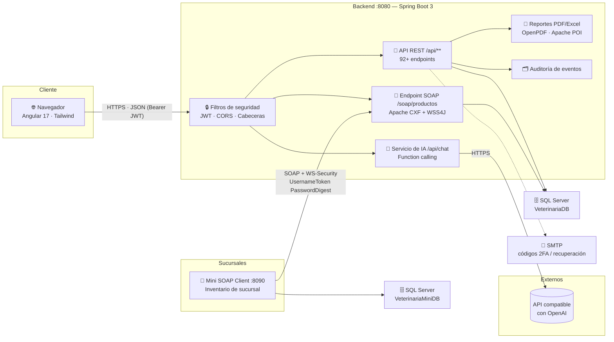
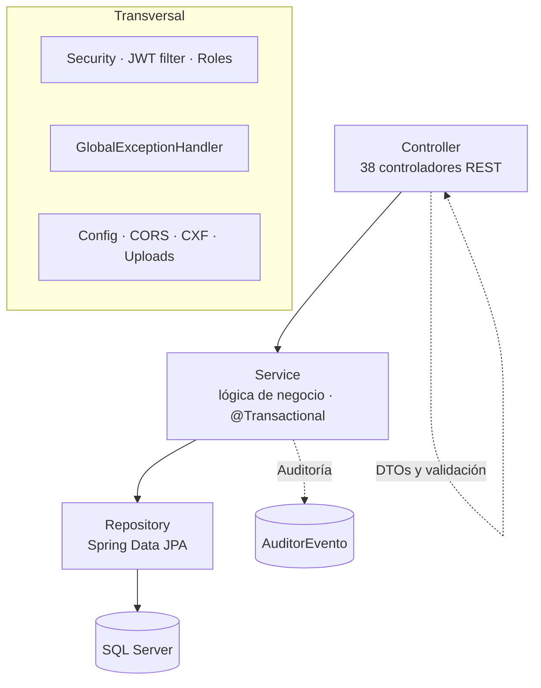
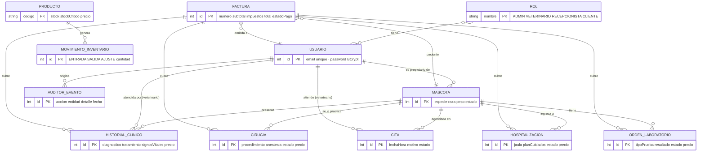
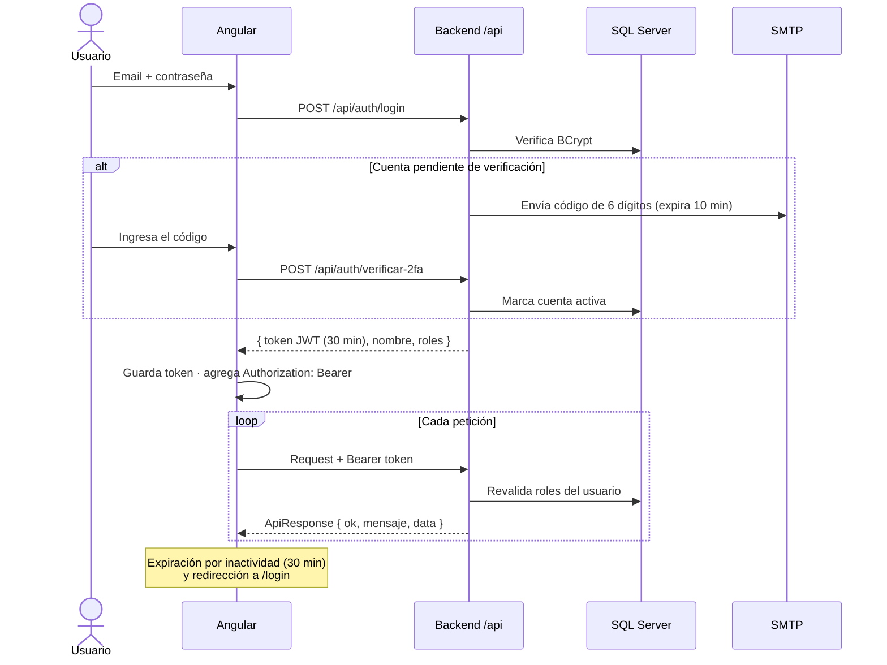
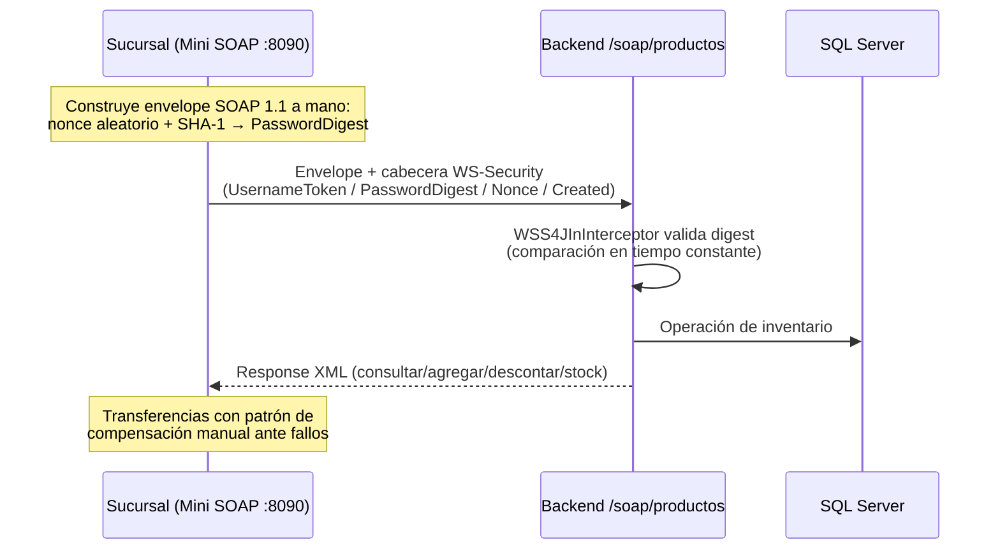
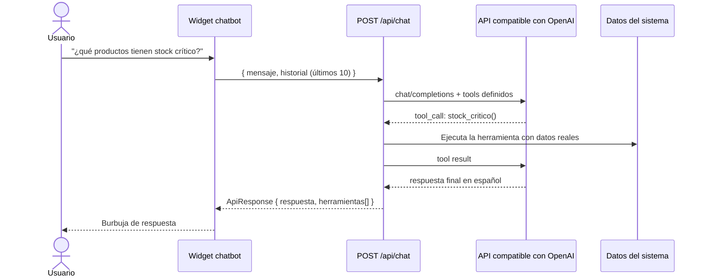

# 🏗️ Arquitectura de VetSphere

VetSphere es un sistema de información clínica veterinaria con **arquitectura híbrida REST + SOAP**: una SPA Angular consume una API REST JSON, y la integración B2B con sucursales se hace por SOAP 1.1 con WS-Security.

---

## 1. Vista de componentes

## 2. Arquitectura por capas del backend

Patrones aplicados:
- **Envoltorio único de respuesta:** todo endpoint responde `{ ok, mensaje, data }` (clase `ApiResponse<T>`), lo que unifica manejo de errores y éxitos en el cliente.
- **Autorización declarativa por URL** en `SecurityConfig` + verificación de propiedad (un CLIENTE solo ve sus mascotas).
- **Lógica de negocio en servicios transaccionales**; los controladores solo validan y delegan.
- **Precios configurables** (`TarifaService`) en lugar de constantes incrustadas.

## 3. Modelo de datos principal

Notas de integridad:
- La vinculación de servicios clínicos a facturas es una relación JPA (`facturaId` se expone en JSON por compatibilidad).
- El stock se modifica solo dentro de `@Transactional` con bloqueo pesimista, y cada cambio genera un `MovimientoInventario` con stock anterior/posterior.
- La auditoría es persistente (no en memoria): login, cambios de stock, facturas emitidas y eliminaciones críticas quedan registrados con usuario y fecha.

## 4. Flujo de autenticación (JWT + 2FA)

## 5. Integración SOAP con WS-Security

Operaciones expuestas: `consultarProducto`, `agregarStock`, `descontarStock`, `actualizarStock`, `stockCritico`. El WSDL se publica en `/soap/productos?wsdl`. En el frontend, la sección de Farmacia incluye un panel para probar la integración SOAP.

## 6. Asistente de IA (function calling)

Herramientas disponibles: `dashboard_resumen`, `buscar_mascotas`, `stock_critico`, `citas_pendientes`, `resumen_facturacion`, `informacion_usuario`. Máximo 3 iteraciones de herramientas por mensaje; sin `CHAT_API_KEY` el sistema responde sin errores.

## 7. Decisiones de diseño relevantes

| Decisión | Justificación |
|---|---|
| REST para el frontend, SOAP para la integración B2B | REST por simpleza en SPA; SOAP por contrato tipado e industria (WS-Security) en la integración entre sistemas |
| JWT stateless + revalidación de roles en cada petición | Los cambios de rol surten efecto inmediato, sin revocar tokens |
| Cálculo de totales **solo en el servidor** | Evita manipulación de precios por parte del cliente |
| Envoltorio `{ok, mensaje, data}` | Manejo uniforme de errores en el frontend |
| Auditoría persistente | Requisito de trazabilidad alineado a ISO/IEC 27001 |
| Precios en configuración (`TarifaService`) | Cambiar tarifas no requiere recompilar |
| Paginación opcional (`?page=&size=`) | Compatibilidad hacia atrás con clientes existentes |
| Perfil `local` con datos de demostración | Reproducibilidad de demos y pruebas sin exponer datos reales |

## 8. Alineación con normas

- **ISO/IEC 25010:2023** — el informe de calidad interno (`/calidad-software` en la app, rol ADMIN) evalúa las 8 características de calidad de producto; el backend mide cobertura con JaCoCo y el frontend con Karma/Jasmine.
- **ISO/IEC 27001/27010** — controles: BCrypt, JWT con expiración, WS-Security, endurecimiento XML (anti-XXE), validación de entrada, whitelist de archivos subidos, auditoría de eventos y manejo de secretos por variables de entorno (nunca en el repositorio).
